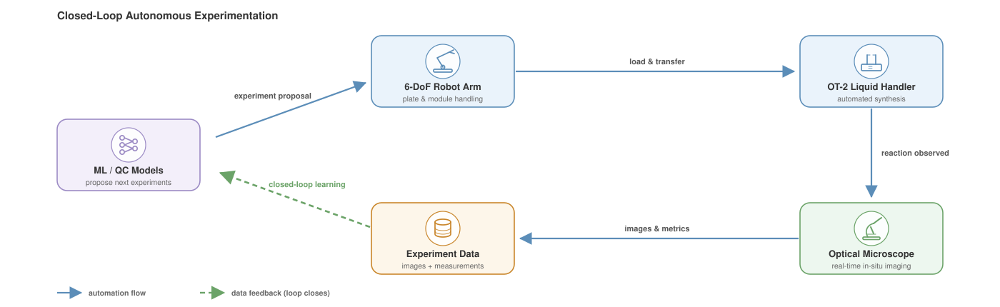

# Hi, I'm Strathmore 👋

**PhD Researcher @ [ShanghaiTech University](https://www.shanghaitech.edu.cn/en/)** — bridging wet-lab chemistry, laboratory automation, and machine learning.

I build closed-loop experimental systems where **custom automation hardware** — a **6-DoF robotic arm**, an **Opentrons OT-2 liquid handler**, and a **real-time optical microscope** for in-situ reaction monitoring — and **ML / quantum-chemistry models** feed each other: models propose what to make, robots make it, the microscope watches, and the data loops back.

<picture>
  <source media="(prefers-color-scheme: dark)" srcset="./assets/closed-loop-dark.svg">
  
</picture>

## 🔬 Research Interests

- **ML-driven materials discovery** — cocrystal prediction, SHAP interpretability, chemical-space exploration
- **Causal inference × quantum chemistry** — QC calculations as interventional data (do-operators) to adjudicate competing mechanism hypotheses
- **Laboratory automation** — OT-2 protocol engineering, autonomous experiment loops, vision-based reaction monitoring
- **Bayesian optimization for experiments** — multi-fidelity BO connecting models with physical experiments

## 🧪 Featured Projects

### 🧊 [Cocrystal](https://github.com/Strathm0re/Cocrystal)

**Data-driven discovery of polar organic cocrystals** — ML prediction (XGBoost + SHAP force-plot analysis, fine-tuned MolCLR embeddings + t-SNE of chemical space) integrated with automated screening and CV classification.

`Python` `RDKit` `scikit-learn` `XGBoost` `OpenCV`

📄 **Published**: [*J. Am. Chem. Soc.* **2025**, *147* (49), 45523–45535](https://doi.org/10.1021/jacs.5c16276)

### ⚛️ [CausalQC-Agent](https://github.com/Strathm0re/causal-agent)

LLM agent that adjudicates **competing mechanism hypotheses** in molecular materials — translating structure–property debates into causal graphs, then selecting the highest-information quantum-chemistry interventions to let calculations rule hypotheses in or out.

`PySCF` `LLM Agents` `Causal Inference` `BOED`

*🚧 in active development*

### 🤖 Lab Automation Toolkit

OT-2 protocol generation, dual-camera CV station for reaction trays, and image-host pipelines for experiment records. *(private while in preparation)*

## 🛠 Tech Stack

## 📊 GitHub Stats

  
  

---

📫 **Contact**: yumy2022@shanghaitech.edu.cn

<!-- Profile README · maintained by Strathmore -->
